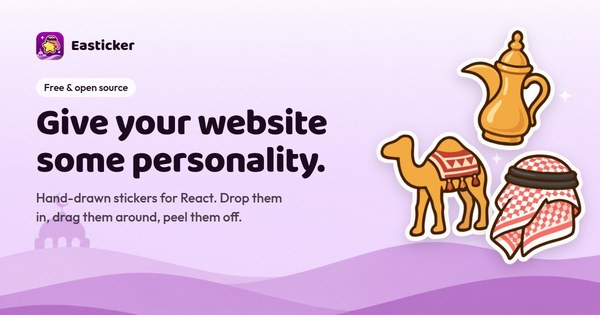

<p align="center">
  
</p>

<p align="center">
  <code>السلام عليكم</code> · <code>bonjour</code> · <code>hello</code>
</p>

<h3>&nbsp; whoami</h3>

```text
$ whoami
salah eddine m'hamda bouloudani

  location ..... montpellier, france
  role ......... full-stack web developer
  also ......... devops enthusiast · ai adopter
  speaks ....... arabic · french · english
  likes ........ building things that feel handmade, on the web
```

<h3>&nbsp; what i'm into</h3>

```text
+------------------------------+----------------------------------------------+
| automation & ai              | agents, scripts and workflows that do the    |
|                              | boring parts, so the interesting ones get    |
|                              | the time                                     |
+------------------------------+----------------------------------------------+
| devops & security            | ci/cd, servers, deploys at the edge, and     |
|                              | keeping all of it locked down                |
+------------------------------+----------------------------------------------+
| ui & design systems          | components, tokens, brand identities         |
+------------------------------+----------------------------------------------+
| arabic ui design  <- focus   | right-to-left interfaces, arabic type and    |
|                              | lettering, heritage motifs in modern ui      |
+------------------------------+----------------------------------------------+
| creative coding              | shaders, dithering, generative motion        |
|                              | (the banner above is one)                    |
+------------------------------+----------------------------------------------+
```

<h3>&nbsp; current projects</h3>

<table>
  <tr>
    <td width="50%" valign="top">
      
      <p><b>Florii · فلوري</b> &nbsp;<sub><code>html</code> <code>canvas</code> <code>cloudflare workers</code></sub></p>
      <p>Type a name and its letters grow into a garden. Arabic first: words are shaped and joined properly, stems sprout from each letter's strokes, and harakat turn into buds, star flowers and dew.</p>
      <p><sub>poster & wallpaper export · eid / ramadan cards · name meanings · nature sounds</sub></p>
    </td>
    <td width="50%" valign="top">
      
      <p><b>Easticker · إيستيكر</b> &nbsp;<sub><code>react</code> <code>typescript</code> <code>astro</code> <code>npm</code></sub></p>
      <p>Hand-drawn React stickers with an Arabic soul: calligraphy words, heritage objects and desert animals, each with a die-cut border and a vinyl peel effect.</p>
      <p><sub>sticker packs (algeria, saudi arabia) · sticker lab for posts & stories · en / ar</sub></p>
    </td>
  </tr>
</table>

<h3>&nbsp; stack</h3>

```text
front ....... typescript · react · astro · next.js · tailwind · shadcn/ui
back ........ node · python · rest apis · sqlite / drizzle
ops ......... docker · github actions · cloudflare workers · linux / vps
ai .......... llm agents · automation pipelines
design ...... svg · konva · arabic typography · rtl layouts
```

<h3>&nbsp; activity</h3>

<p align="center">
  
</p>
<p align="center"><sub>refreshed daily by a github action from the github graphql api</sub></p>

<h3>&nbsp; say hi</h3>

```text
$ contact --list
  linkedin ..... linkedin.com/in/salah-eddine-m-hamda-bouloudani-82b75a28a
  website ...... soon
```

<p>
  <a href="https://www.linkedin.com/in/salah-eddine-m-hamda-bouloudani-82b75a28a/"></a>
</p>

<p align="center"><sub> icons: <a href="https://github.com/vijayksingh/dither-icons">dither-icons</a> (MIT) · banner: a dither shader ported to python</sub></p>
