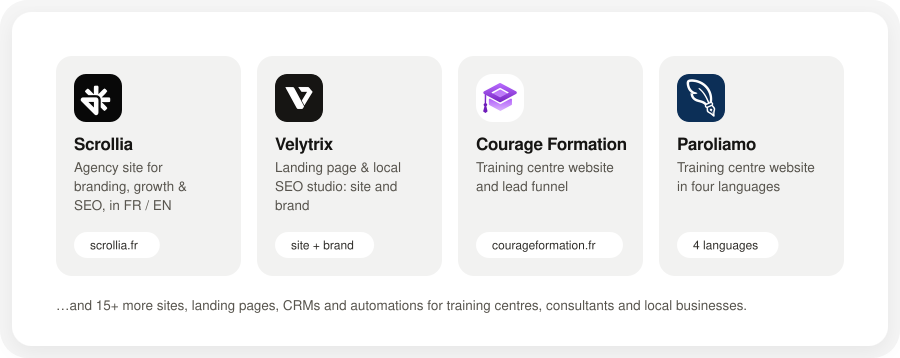
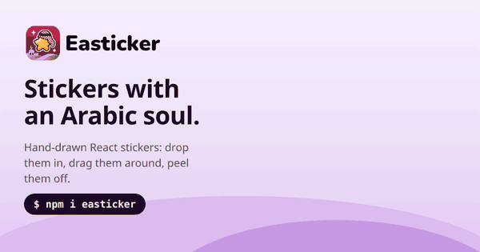
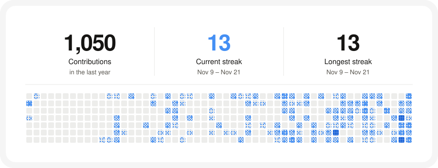

  

## Hello there, I'm Salah Eddine! 👋

- 🎓 Software engineering at **the University of Montpellier**. Originally from Algeria 🇩🇿, now based in Montpellier 🇫🇷.
- 🛠️ **DevOps enthusiast**, **full-stack developer** and **software engineer**, with **20+ web projects delivered** for clients.
- 🤖 I thrive at the intersection of **automation**, **AI agents & prompt engineering**, and **security**.
- 🎨 Soft spot for **Arabic UI design**: right-to-left interfaces, Arabic lettering and heritage motifs.
- 🗣️ I speak Arabic, French and English.
- 🌱 Open to opportunities. Reach me on [LinkedIn](https://www.linkedin.com/in/salah-eddine-m-hamda-bouloudani-82b75a28a/).

## Reach me

## Experience

<picture>
  <source media="(prefers-color-scheme: dark)" srcset="assets/experience-dark.svg">
  
</picture>

## Featured builds

- ⚙️ **Scrollia Automation**, in production: a social media pipeline that pulls content from Google Drive, writes captions with AI, renders branded thumbnails, then schedules and publishes to several platforms, with a Next.js dashboard to review and retry. 
  Python · FastAPI · Next.js · LLMs · Docker · Coolify
- 🔒 **Scruti**, built at Octodet: a security and vulnerability management project. 
  osquery · Elasticsearch · Ansible · Python · LLMs

## Client work

<picture>
  <source media="(prefers-color-scheme: dark)" srcset="assets/clients-dark.svg">
  
</picture>

Live: <a href="https://scrollia.fr">scrollia.fr</a> · <a href="https://courageformation.fr">courageformation.fr</a>

## Side projects: Arabic UI

<table>
  <tr>
    <td width="50%" valign="top">
       
      &nbsp;<b>Florii · فلوري</b> 
      &nbsp;Type a name and its letters grow into a garden, Arabic first.
    </td>
    <td width="50%" valign="top">
       
      &nbsp;<b>Easticker · إيستيكر</b> 
      &nbsp;Hand-drawn React stickers with an Arabic soul.
    </td>
  </tr>
  <tr>
    <td colspan="2" align="center">🚧 &nbsp;<b>More Arabic UI projects coming soon</b></td>
  </tr>
</table>

## Languages and technologies

   
  

Also: osquery · Oracle · Coolify · FastAPI · CrewAI · LLMs & AI agents · Canva

## Certifications

- 🤖 Evaluating AI Agents: From Metrics to Real-World Impact · *365 Data Science, Nov 2025*
- ☁️ Intro to Microsoft Azure · *365 Data Science, Nov 2025*
- 🧩 Multi Agent Systems · *CrewAI, Feb 2025*
- 🏅 AWS Academy Graduate: Cloud Foundations · *AWS Academy, Dec 2024*

## GitHub stats

<picture>
  <source media="(prefers-color-scheme: dark)" srcset="assets/stats-dark.svg">
  
</picture>

  

