  

  🇩🇿 &nbsp;<code>السلام عليكم</code> · <code>bonjour</code> · <code>hello</code>&nbsp; 🇫🇷

  I build and ship web products end to end, then automate everything around them: 
  deploys, servers, security checks and the repetitive work, increasingly with AI agents. 
  <b>20+ projects delivered</b> · <b>open to opportunities</b>

<h3>&nbsp; About me</h3>

<picture>
  <source media="(prefers-color-scheme: dark)" srcset="assets/about-dark.svg">
  
</picture>

<h3>&nbsp; Experience</h3>

<picture>
  <source media="(prefers-color-scheme: dark)" srcset="assets/experience-dark.svg">
  
</picture>

<h3>&nbsp; Featured builds</h3>

<table>
  <tr>
    <td width="50%" valign="top">
      
<b>Scrollia Automation</b> Automation · in production

      
End-to-end social media pipeline for the Scrollia agency, with a dashboard to review, reschedule and retry posts.

      <ol>
        <li>Pulls content from Google Drive</li>
        <li>Writes captions with AI and renders branded thumbnails</li>
        <li>Schedules and publishes to several platforms</li>
        <li>Checks every post went out, and retries the ones that didn't</li>
      </ol>
      
<code>python</code> <code>fastapi</code> <code>next.js</code> <code>llms</code> <code>zernio api</code> <code>gohighlevel api</code> <code>docker</code> <code>coolify</code>

    </td>
    <td width="50%" valign="top">
      
<b>Scruti</b> Security · built at Octodet

      
Security and vulnerability management project.

      <ul>
        <li>Visibility on machines with osquery</li>
        <li>Vulnerability data collected and searched in Elasticsearch</li>
        <li>Automated response with Ansible</li>
        <li>LLMs and AI agents in the loop</li>
      </ul>
      
<code>osquery</code> <code>elasticsearch</code> <code>ansible</code> <code>python</code> <code>llms</code>

    </td>
  </tr>
</table>

<h3>&nbsp; Client work &nbsp;20+ delivered</h3>

| | Project | What I built | Stack |
|:-:|---|---|---|
|  | **[Scrollia](https://scrollia.fr)** | Marketing agency site: personal branding, growth & SEO, in French and English | Astro, Tailwind, React |
|  | **Velytrix** | Landing page & local SEO studio: website and full brand identity | Astro, SEO, branding |
|  | **[Courage Formation](https://courageformation.fr)** | Training organization website and lead funnel | Astro, Tailwind |
|  | **Paroliamo** | Training organization website in 4 languages | Astro, TypeScript, i18n |
| ➕ | **And more** | Sites, landing pages, CRMs and automations for training centres, consultants and local businesses | Astro, TypeScript, Python |

<h3>&nbsp; Side projects: Arabic UI</h3>

<table>
  <tr>
    <td width="50%" valign="top">
      
      
<b>Florii · فلوري</b> &nbsp;<code>html</code> <code>canvas</code> <code>cloudflare workers</code>

      
Type a name and its letters grow into a garden. Arabic first: words are shaped and joined properly, stems sprout from each letter's strokes, and harakat turn into buds, star flowers and dew.

      
Poster & wallpaper export · Eid / Ramadan cards · name meanings · nature sounds

    </td>
    <td width="50%" valign="top">
      
      
<b>Easticker · إيستيكر</b> &nbsp;<code>react</code> <code>typescript</code> <code>astro</code> <code>npm</code>

      
Hand-drawn React stickers with an Arabic soul: calligraphy words, heritage objects and desert animals, each with a die-cut border and a vinyl peel effect.

      
Sticker packs: Algeria 🇩🇿, Saudi Arabia · Sticker Lab for posts & stories · English / Arabic

    </td>
  </tr>
</table>

<h3>&nbsp; What I'm into</h3>

| Interest | What that means |
|---|---|
| **DevOps** | CI/CD, servers, virtualization, backups, deploys at the edge |
| **Security** | Vulnerability management, endpoint visibility, keeping things locked down |
| **Automation & AI agents** | Multi-agent systems, prompt engineering, scripts that do the boring parts |
| **Arabic UI design** ⭐ | Right-to-left interfaces, Arabic type and lettering, heritage motifs in modern UI |
| **UI & creative coding** | Design systems, shaders, dithering (the banner above is one) |

<h3>&nbsp; Stack</h3>

<table>
  <tr>
    <td width="150"><b>Web</b></td>
    <td> TypeScript, React, Astro, Next.js, Tailwind, Node.js</td>
  </tr>
  <tr>
    <td width="150"><b>DevOps</b></td>
    <td> Docker, Coolify, Ansible, GitHub Actions, Cloudflare Workers, Linux, Shell</td>
  </tr>
  <tr>
    <td width="150"><b>Security</b></td>
    <td> osquery, Elasticsearch, vulnerability management</td>
  </tr>
  <tr>
    <td width="150"><b>AI & automation</b></td>
    <td> Python, LLMs, AI agents, CrewAI, prompt engineering, LLMOps, web scraping</td>
  </tr>
  <tr>
    <td width="150"><b>Data & cloud</b></td>
    <td> Oracle, SQLite, AWS, Azure</td>
  </tr>
  <tr>
    <td width="150"><b>Design</b></td>
    <td> Figma, Canva, UI/UX, design systems, branding Multilingual layouts: Arabic (RTL), French, English</td>
  </tr>
</table>

<h3>&nbsp; Certifications</h3>

| Date | Certificate | Issuer |
|---|---|---|
| Nov 2025 | Evaluating AI Agents: From Metrics to Real-World Impact | 365 Data Science |
| Nov 2025 | Intro to Microsoft Azure | 365 Data Science |
| Feb 2025 | Multi Agent Systems | CrewAI |
| Dec 2024 | AWS Academy Graduate: Cloud Foundations | AWS Academy |

<h3>&nbsp; Activity</h3>

  

Built from the GitHub GraphQL API by a GitHub Action

<h3>&nbsp; Contact</h3>

Open to opportunities in **DevOps**, **full-stack** and **automation**. The best way to reach me is LinkedIn.

  

 icons: <a href="https://github.com/vijayksingh/dither-icons">dither-icons</a> (MIT) · banner: a dither shader ported to python · 🇩🇿 → 🇫🇷

