  

<h3>I build web products end to end, and <ins>automate</ins> everything around them.</h3>

DevOps enthusiast, full-stack developer and software engineer. I ship client websites, automation pipelines and AI agents, with a soft spot for security and for Arabic UI design.

 &nbsp;
<a href="https://www.linkedin.com/in/salah-eddine-m-hamda-bouloudani-82b75a28a/">LinkedIn</a> &nbsp;·&nbsp;
<a href="https://scrollia.fr">scrollia.fr</a> &nbsp;·&nbsp;
<a href="https://courageformation.fr">courageformation.fr</a>

> NOW 
>  &nbsp;**Velytrix** &nbsp; 
> My studio: landing pages and local SEO for small businesses. velytrix.fr · launching soon

- **Based in** &nbsp;Montpellier, France 🇫🇷 from Algeria 🇩🇿
- **Focus** &nbsp;Automation, AI agents and security
- **Track record** &nbsp;20+ projects delivered for clients
- **Languages** &nbsp;Arabic, French and English

## 01 · Experience

### Software Developer · Octodet
Jan → Jun 2025 · Internship · Remote

- Automation, prompt engineering and AI agents (LLMs, LLMOps, web scraping)
- Security and vulnerability management
- Built Scruti, a security project

<kbd>Python</kbd> <kbd>osquery</kbd> <kbd>Elasticsearch</kbd> <kbd>Ansible</kbd> <kbd>LLMs</kbd>

### Software Engineer · GTFT
Dec 2024 · Internship · Illizi, Algeria

- Network infrastructure and virtualization for server management
- Server replication, risk prevention and disaster recovery
- Software management and deployment

<kbd>Networking</kbd> <kbd>Virtualization</kbd> <kbd>Replication</kbd>

### Software Engineer · Sonatrach
Jul 2024 · Internship · Skikda, Algeria

- Automated backup scripts for the company servers
- Oracle database administration: monitoring, maintenance, security
- Supported the infrastructure team on enterprise applications

<kbd>Shell</kbd> <kbd>Oracle</kbd> <kbd>Sysadmin</kbd>

## 02 · Featured builds

### Scrollia Automation &nbsp;
Social media pipeline for the Scrollia agency: pulls content from Google Drive, writes captions with AI, renders branded thumbnails, then schedules and publishes to several platforms. A Next.js dashboard reviews and retries posts.

<kbd>Python</kbd> <kbd>FastAPI</kbd> <kbd>Next.js</kbd> <kbd>LLMs</kbd> <kbd>Docker</kbd> <kbd>Coolify</kbd>

### Scruti &nbsp;
Security and vulnerability management project, built during my internship at Octodet.

<kbd>osquery</kbd> <kbd>Elasticsearch</kbd> <kbd>Ansible</kbd> <kbd>Python</kbd> <kbd>LLMs</kbd>

## 03 · Client work

-  &nbsp;[**Scrollia**](https://scrollia.fr) · Agency site for branding, growth and SEO, in French and English
-  &nbsp;[**Courage Formation**](https://courageformation.fr) · Training centre website and lead funnel
-  &nbsp;**Paroliamo** · Training centre website in four languages

And 15+ more sites, landing pages, CRMs and automations for training centres, consultants and local businesses.

## 04 · Side projects

Arabic UI experiments: Arabic-first type, motion and playful interfaces.

  
  

-  &nbsp;**Florii** · فلوري · Type a name and its letters grow into a garden, Arabic first.
-  &nbsp;**Easticker** · إيستيكر · Hand-drawn React stickers with an Arabic soul.
-  &nbsp;More Arabic UI projects on the way.

## 05 · Stack

**Web** 
<picture><source media="(prefers-color-scheme: dark)" srcset="https://skillicons.dev/icons?i=ts&theme=dark"></picture>&nbsp;TypeScript &nbsp;&nbsp; <picture><source media="(prefers-color-scheme: dark)" srcset="https://skillicons.dev/icons?i=js&theme=dark"></picture>&nbsp;JavaScript &nbsp;&nbsp; <picture><source media="(prefers-color-scheme: dark)" srcset="https://skillicons.dev/icons?i=react&theme=dark"></picture>&nbsp;React &nbsp;&nbsp; <picture><source media="(prefers-color-scheme: dark)" srcset="https://skillicons.dev/icons?i=nextjs&theme=dark"></picture>&nbsp;Next.js &nbsp;&nbsp; <picture><source media="(prefers-color-scheme: dark)" srcset="https://skillicons.dev/icons?i=astro&theme=dark"></picture>&nbsp;Astro &nbsp;&nbsp; <picture><source media="(prefers-color-scheme: dark)" srcset="https://skillicons.dev/icons?i=tailwind&theme=dark"></picture>&nbsp;Tailwind &nbsp;&nbsp; <picture><source media="(prefers-color-scheme: dark)" srcset="https://skillicons.dev/icons?i=nodejs&theme=dark"></picture>&nbsp;Node.js &nbsp;&nbsp; <picture><source media="(prefers-color-scheme: dark)" srcset="https://skillicons.dev/icons?i=html&theme=dark"></picture>&nbsp;HTML &nbsp;&nbsp; <picture><source media="(prefers-color-scheme: dark)" srcset="https://skillicons.dev/icons?i=css&theme=dark"></picture>&nbsp;CSS

**DevOps** 
<picture><source media="(prefers-color-scheme: dark)" srcset="https://skillicons.dev/icons?i=docker&theme=dark"></picture>&nbsp;Docker &nbsp;&nbsp; <picture><source media="(prefers-color-scheme: dark)" srcset="https://skillicons.dev/icons?i=ansible&theme=dark"></picture>&nbsp;Ansible &nbsp;&nbsp; <picture><source media="(prefers-color-scheme: dark)" srcset="https://skillicons.dev/icons?i=githubactions&theme=dark"></picture>&nbsp;GitHub Actions &nbsp;&nbsp; <picture><source media="(prefers-color-scheme: dark)" srcset="https://skillicons.dev/icons?i=cloudflare&theme=dark"></picture>&nbsp;Cloudflare Workers &nbsp;&nbsp; <picture><source media="(prefers-color-scheme: dark)" srcset="https://skillicons.dev/icons?i=linux&theme=dark"></picture>&nbsp;Linux &nbsp;&nbsp; <picture><source media="(prefers-color-scheme: dark)" srcset="https://skillicons.dev/icons?i=bash&theme=dark"></picture>&nbsp;Shell &nbsp;&nbsp; <picture><source media="(prefers-color-scheme: dark)" srcset="https://skillicons.dev/icons?i=git&theme=dark"></picture>&nbsp;Git 
Also: Coolify

**Security** 
<picture><source media="(prefers-color-scheme: dark)" srcset="https://skillicons.dev/icons?i=elasticsearch&theme=dark"></picture>&nbsp;Elasticsearch 
Also: osquery · vulnerability management

**AI &amp; automation** 
<picture><source media="(prefers-color-scheme: dark)" srcset="https://skillicons.dev/icons?i=python&theme=dark"></picture>&nbsp;Python 
Also: LLMs · AI agents · CrewAI · prompt engineering · LLMOps · web scraping

**Data &amp; cloud** 
<picture><source media="(prefers-color-scheme: dark)" srcset="https://skillicons.dev/icons?i=sqlite&theme=dark"></picture>&nbsp;SQLite &nbsp;&nbsp; <picture><source media="(prefers-color-scheme: dark)" srcset="https://skillicons.dev/icons?i=aws&theme=dark"></picture>&nbsp;AWS &nbsp;&nbsp; <picture><source media="(prefers-color-scheme: dark)" srcset="https://skillicons.dev/icons?i=azure&theme=dark"></picture>&nbsp;Azure 
Also: Oracle

**Design** 
<picture><source media="(prefers-color-scheme: dark)" srcset="https://skillicons.dev/icons?i=figma&theme=dark"></picture>&nbsp;Figma 
Also: Canva · UI/UX · design systems · branding · Arabic (RTL), French and English layouts

## 06 · Certifications

- **Evaluating AI Agents: From Metrics to Real-World Impact** · 365 Data Science Nov 2025
- **Intro to Microsoft Azure** · 365 Data Science Nov 2025
- **Multi Agent Systems** · CrewAI Feb 2025
- **AWS Academy Graduate: Cloud Foundations** · AWS Academy Dec 2024

## 07 · Activity

<!-- STATS:START -->
**1,094** contributions in the last year &nbsp;·&nbsp; **<ins>14 days</ins>** current streak Nov 9 – Nov 22 &nbsp;·&nbsp; **14 days** longest streak Nov 9 – Nov 22

<picture>
  <source media="(prefers-color-scheme: dark)" srcset="assets/heatmap-dark.svg">
  
</picture>
<!-- STATS:END -->
