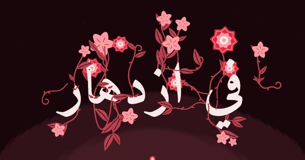

<p align="center">
  
</p>

<p align="center">
  🇩🇿 &nbsp;<code>السلام عليكم</code> · <code>bonjour</code> · <code>hello</code>&nbsp; 🇫🇷
</p>

<p align="center">
  I build and ship web products end to end, then automate everything around them:<br>
  deploys, servers, security checks and the repetitive work, increasingly with AI agents.<br>
  <b>20+ projects delivered</b> · <b>open to opportunities</b>
</p>

<h3>&nbsp; whoami</h3>

```text
$ whoami
salah eddine m'hamda bouloudani

  from ......... algeria
  based in ..... montpellier, france
  studies ...... university of montpellier
  role ......... devops enthusiast · full-stack developer · software engineer
  focus ........ automation · prompt engineering · ai agents · security
  delivered .... 20+ web projects for clients
  speaks ....... arabic · french · english
  status ....... open to opportunities
```

<h3>&nbsp; experience</h3>

```text
2025.01 → 2025.06   software developer · octodet                internship · remote
                    automation, prompt engineering, ai agents, llms / llmops,
                    web scraping, security & vulnerability management
                    (osquery · elasticsearch · ansible · python)
                    └─ built scruti, see featured builds

2024.12             software engineer · gtft                    internship · illizi, dz
                    network infrastructure, virtualization, server replication,
                    risk prevention & disaster recovery, software deployment

2024.07             software engineer · sonatrach               internship · skikda, dz
                    automated server backup scripts (shell), oracle database
                    administration, support for enterprise applications
```

<h3>&nbsp; featured builds</h3>

```text
+---------------------------------------------------------------------------+
|  SCROLLIA AUTOMATION                           automation · in production |
|                                                                           |
|  end-to-end social media pipeline for the scrollia agency:                |
|    google drive intake  ->  ai captions & branded thumbnails              |
|    ->  scheduling  ->  multi-platform publishing  ->  reconciliation      |
|  with a next.js dashboard to review, reschedule and retry posts.          |
|                                                                           |
|  python · fastapi · next.js · llms · zernio & gohighlevel apis            |
|  docker · coolify                                                         |
+---------------------------------------------------------------------------+

+---------------------------------------------------------------------------+
|  SCRUTI                                       security · built at octodet |
|                                                                           |
|  security & vulnerability management project: visibility on machines,     |
|  vulnerability tracking and automated response.                           |
|                                                                           |
|  osquery · elasticsearch · ansible · python · llms / ai agents            |
+---------------------------------------------------------------------------+
```

<h3>&nbsp; client work &nbsp;<sub>20+ delivered</sub></h3>

| | project | what | stack |
|:-:|---|---|---|
|  | **[Scrollia](https://scrollia.fr)** | marketing agency: personal branding, growth & SEO, FR / EN | astro · tailwind · react |
|  | **Velytrix** | landing pages & local SEO studio, website + full brand identity | astro · seo · branding |
|  | **[Courage Formation](https://courageformation.fr)** | training organization website + lead funnel | astro · tailwind |
|  | **Paroliamo** | training organization website in 4 languages | astro · typescript · i18n |
| ➕ | **+ more** | sites, landing pages, CRMs and automations for training centres, consultants and local businesses | astro · ts · python |

<h3>&nbsp; side projects: arabic ui</h3>

<table>
  <tr>
    <td width="50%" valign="top">
      
      <p><b>Florii · فلوري</b> &nbsp;<sub><code>html</code> <code>canvas</code> <code>cloudflare workers</code></sub></p>
      <p>Type a name and its letters grow into a garden. Arabic first: words are shaped and joined properly, stems sprout from each letter's strokes, and harakat turn into buds, star flowers and dew.</p>
      <p><sub>poster & wallpaper export · eid / ramadan cards · name meanings · nature sounds</sub></p>
    </td>
    <td width="50%" valign="top">
      
      <p><b>Easticker · إيستيكر</b> &nbsp;<sub><code>react</code> <code>typescript</code> <code>astro</code> <code>npm</code></sub></p>
      <p>Hand-drawn React stickers with an Arabic soul: calligraphy words, heritage objects and desert animals, each with a die-cut border and a vinyl peel effect.</p>
      <p><sub>sticker packs (algeria 🇩🇿, saudi arabia) · sticker lab for posts & stories · en / ar</sub></p>
    </td>
  </tr>
</table>

<h3>&nbsp; what i'm into</h3>

```text
+------------------------------+----------------------------------------------+
| devops                       | ci/cd, servers, virtualization, backups and  |
|                              | deploys at the edge                          |
+------------------------------+----------------------------------------------+
| security                     | vulnerability management, endpoint           |
|                              | visibility, keeping things locked down       |
+------------------------------+----------------------------------------------+
| automation & ai agents       | multi-agent systems, prompt engineering,     |
|                              | scripts that do the boring parts             |
+------------------------------+----------------------------------------------+
| arabic ui design  <- focus   | right-to-left interfaces, arabic type and    |
|                              | lettering, heritage motifs in modern ui      |
+------------------------------+----------------------------------------------+
| ui & creative coding         | design systems, shaders, dithering           |
|                              | (the banner above is one)                    |
+------------------------------+----------------------------------------------+
```

<h3>&nbsp; stack</h3>

<table>
  <tr>
    <td width="150"><b>Web</b></td>
    <td><br><sub>TypeScript, React, Astro, Next.js, Tailwind, Node.js</sub></td>
  </tr>
  <tr>
    <td width="150"><b>DevOps</b></td>
    <td><br><sub>Docker, Coolify, Ansible, GitHub Actions, Cloudflare Workers, Linux, Shell</sub></td>
  </tr>
  <tr>
    <td width="150"><b>Security</b></td>
    <td><br><sub>osquery, Elasticsearch, vulnerability management</sub></td>
  </tr>
  <tr>
    <td width="150"><b>AI & automation</b></td>
    <td><br><sub>Python, LLMs, AI agents, CrewAI, prompt engineering, LLMOps, web scraping</sub></td>
  </tr>
  <tr>
    <td width="150"><b>Data & cloud</b></td>
    <td><br><sub>Oracle, SQLite, AWS, Azure</sub></td>
  </tr>
  <tr>
    <td width="150"><b>Design</b></td>
    <td><br><sub>Figma, Canva, UI/UX, design systems, branding<br>Multilingual layouts: Arabic (RTL), French, English</sub></td>
  </tr>
</table>

<h3>&nbsp; certifications</h3>

```text
2025.11   evaluating ai agents: from metrics to real-world impact   365 data science
2025.11   intro to microsoft azure                                  365 data science
2025.02   multi agent systems                                       crewai
2024.12   aws academy graduate: cloud foundations                   aws academy
```

<h3>&nbsp; activity</h3>

<p align="center">
  
</p>
<p align="center"><sub>built from the github graphql api by a github action</sub></p>

<h3>&nbsp; say hi</h3>

```text
$ contact --list
  linkedin ..... linkedin.com/in/salah-eddine-m-hamda-bouloudani-82b75a28a
  status ....... open to opportunities, devops / full-stack / automation
```

<p>
  <a href="https://www.linkedin.com/in/salah-eddine-m-hamda-bouloudani-82b75a28a/"></a>
</p>

<p align="center"><sub> icons: <a href="https://github.com/vijayksingh/dither-icons">dither-icons</a> (MIT) · banner: a dither shader ported to python · 🇩🇿 → 🇫🇷</sub></p>
