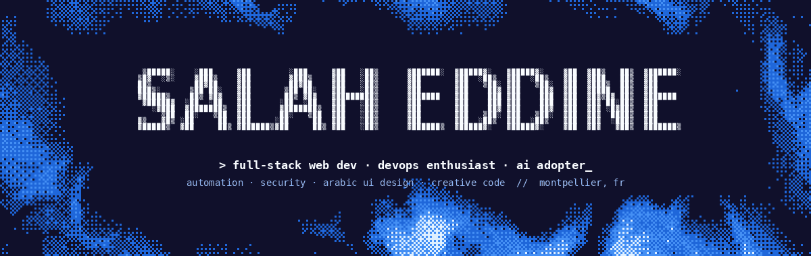

  

<h3>I build web products end to end, and <ins>automate</ins> everything around them.</h3>

DevOps enthusiast, full-stack developer and software engineer. I ship client websites, automation pipelines and AI agents, with a soft spot for security and for Arabic UI design.

 &nbsp;
<a href="https://www.linkedin.com/in/salah-eddine-m-hamda-bouloudani-82b75a28a/">LinkedIn</a> &nbsp;·&nbsp;
<a href="https://scrollia.fr">scrollia.fr</a> &nbsp;·&nbsp;
<a href="https://courageformation.fr">courageformation.fr</a>

<table>
<tr>
<td width="64" valign="top"></td>
<td valign="top">
NOW 
<b>Velytrix</b> &nbsp; 
My studio: landing pages and local SEO for small businesses. 
velytrix.fr · launching soon
</td>
</tr>
</table>

| Based in | Focus | Track record | Languages |
|---|---|---|---|
| Montpellier, France 🇫🇷 from Algeria 🇩🇿 | Automation, AI agents and security | 20+ projects delivered for clients | Arabic, French and English |

## 01 · Experience

<table>
<tr>
<td width="30%" valign="top"><b>Octodet</b> Jan → Jun 2025 Internship · Remote</td>
<td valign="top">
<b>Software Developer</b>
<ul>
<li>Automation, prompt engineering and AI agents (LLMs, LLMOps, web scraping)</li>
<li>Security and vulnerability management</li>
<li>Built Scruti, a security project</li>
</ul>
<kbd>Python</kbd> <kbd>osquery</kbd> <kbd>Elasticsearch</kbd> <kbd>Ansible</kbd> <kbd>LLMs</kbd>
</td>
</tr>
<tr>
<td valign="top"><b>GTFT</b> Dec 2024 Internship · Illizi, Algeria</td>
<td valign="top">
<b>Software Engineer</b>
<ul>
<li>Network infrastructure and virtualization for server management</li>
<li>Server replication, risk prevention and disaster recovery</li>
<li>Software management and deployment</li>
</ul>
<kbd>Networking</kbd> <kbd>Virtualization</kbd> <kbd>Replication</kbd>
</td>
</tr>
<tr>
<td valign="top"><b>Sonatrach</b> Jul 2024 Internship · Skikda, Algeria</td>
<td valign="top">
<b>Software Engineer</b>
<ul>
<li>Automated backup scripts for the company servers</li>
<li>Oracle database administration: monitoring, maintenance, security</li>
<li>Supported the infrastructure team on enterprise applications</li>
</ul>
<kbd>Shell</kbd> <kbd>Oracle</kbd> <kbd>Sysadmin</kbd>
</td>
</tr>
</table>

## 02 · Featured builds

<table>
<tr>
<td width="50%" valign="top">
<b>Scrollia Automation</b> &nbsp;  
Social media pipeline for the Scrollia agency: pulls content from Google Drive, writes captions with AI, renders branded thumbnails, then schedules and publishes to several platforms. A Next.js dashboard reviews and retries posts.  
<kbd>Python</kbd> <kbd>FastAPI</kbd> <kbd>Next.js</kbd> <kbd>LLMs</kbd> <kbd>Docker</kbd> <kbd>Coolify</kbd>
</td>
<td width="50%" valign="top">
<b>Scruti</b> &nbsp;  
Security and vulnerability management project, built during my internship at Octodet.  
<kbd>osquery</kbd> <kbd>Elasticsearch</kbd> <kbd>Ansible</kbd> <kbd>Python</kbd> <kbd>LLMs</kbd>
</td>
</tr>
</table>

## 03 · Client work

<table>
<tr>
<td width="56" valign="top"></td>
<td valign="top"><a href="https://scrollia.fr"><b>Scrollia</b></a> Agency site for branding, growth and SEO, in French and English</td>
</tr>
<tr>
<td valign="top"></td>
<td valign="top"><a href="https://courageformation.fr"><b>Courage Formation</b></a> Training centre website and lead funnel</td>
</tr>
<tr>
<td valign="top"></td>
<td valign="top"><b>Paroliamo</b> Training centre website in four languages</td>
</tr>
</table>

And 15+ more sites, landing pages, CRMs and automations for training centres, consultants and local businesses.

## 04 · Side projects

Arabic UI experiments: Arabic-first type, motion and playful interfaces.

<table>
<tr>
<td width="50%" valign="top">
  
 &nbsp;<b>Florii</b> · فلوري 
Type a name and its letters grow into a garden, Arabic first.
</td>
<td width="50%" valign="top">
  
 &nbsp;<b>Easticker</b> · إيستيكر 
Hand-drawn React stickers with an Arabic soul.
</td>
</tr>
<tr>
<td colspan="2"> &nbsp;More Arabic UI projects on the way.</td>
</tr>
</table>

## 05 · Stack

| Area | Tools |
|---|---|
| **Web** | <picture><source media="(prefers-color-scheme: dark)" srcset="https://skillicons.dev/icons?i=ts,js,react,nextjs,astro,tailwind,nodejs,html,css&theme=dark"></picture> TypeScript · JavaScript · React · Next.js · Astro · Tailwind · Node.js · HTML · CSS |
| **DevOps** | <picture><source media="(prefers-color-scheme: dark)" srcset="https://skillicons.dev/icons?i=docker,ansible,githubactions,cloudflare,linux,bash,git&theme=dark"></picture> Docker · Coolify · Ansible · GitHub Actions · Cloudflare Workers · Linux · Shell · Git |
| **Security** | <picture><source media="(prefers-color-scheme: dark)" srcset="https://skillicons.dev/icons?i=elasticsearch&theme=dark"></picture> osquery · Elasticsearch · vulnerability management |
| **AI & automation** | <picture><source media="(prefers-color-scheme: dark)" srcset="https://skillicons.dev/icons?i=python&theme=dark"></picture> Python · LLMs · AI agents · CrewAI · prompt engineering · LLMOps · web scraping |
| **Data & cloud** | <picture><source media="(prefers-color-scheme: dark)" srcset="https://skillicons.dev/icons?i=sqlite,aws,azure&theme=dark"></picture> Oracle · SQLite · AWS · Azure |
| **Design** | <picture><source media="(prefers-color-scheme: dark)" srcset="https://skillicons.dev/icons?i=figma&theme=dark"></picture> Figma · Canva · UI/UX · design systems · branding · Arabic (RTL), French and English layouts |

## 06 · Certifications

| Date | Certification | Issuer |
|---|---|---|
| Nov 2025 | Evaluating AI Agents: From Metrics to Real-World Impact | 365 Data Science |
| Nov 2025 | Intro to Microsoft Azure | 365 Data Science |
| Feb 2025 | Multi Agent Systems | CrewAI |
| Dec 2024 | AWS Academy Graduate: Cloud Foundations | AWS Academy |

## 07 · Activity

<!-- STATS:START -->
<table>
<tr>
<td align="center"><h3>1,093</h3>&emsp;Contributions&emsp; in the last year</td>
<td align="center"><h3><ins>14 days</ins></h3>&emsp;Current streak&emsp; Nov 9 – Nov 22</td>
<td align="center"><h3>14 days</h3>&emsp;Longest streak&emsp; Nov 9 – Nov 22</td>
</tr>
</table>

<picture>
  <source media="(prefers-color-scheme: dark)" srcset="assets/heatmap-dark.svg">
  
</picture>
<!-- STATS:END -->
